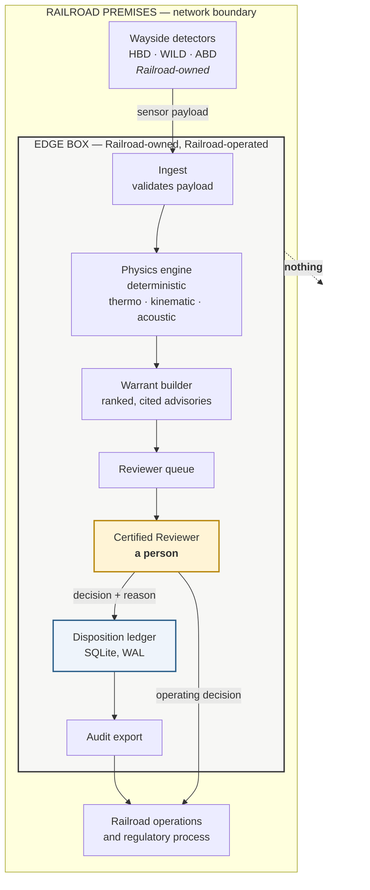
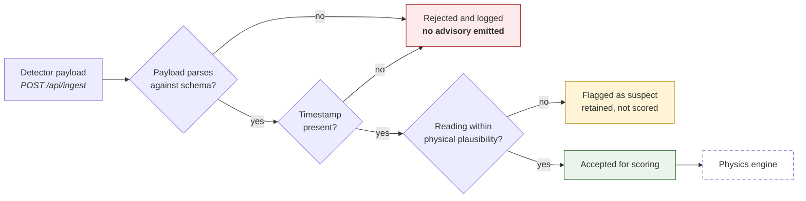
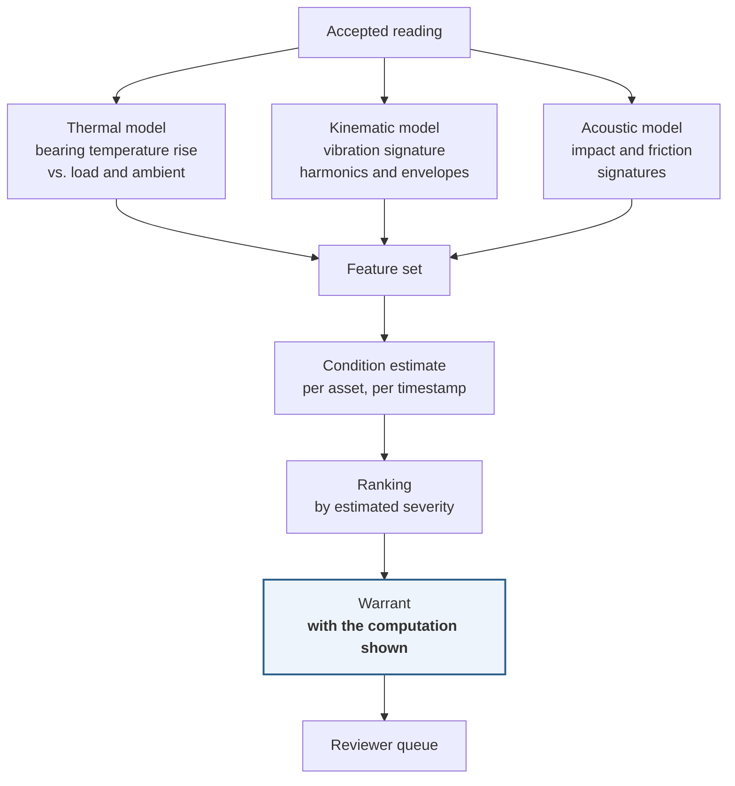
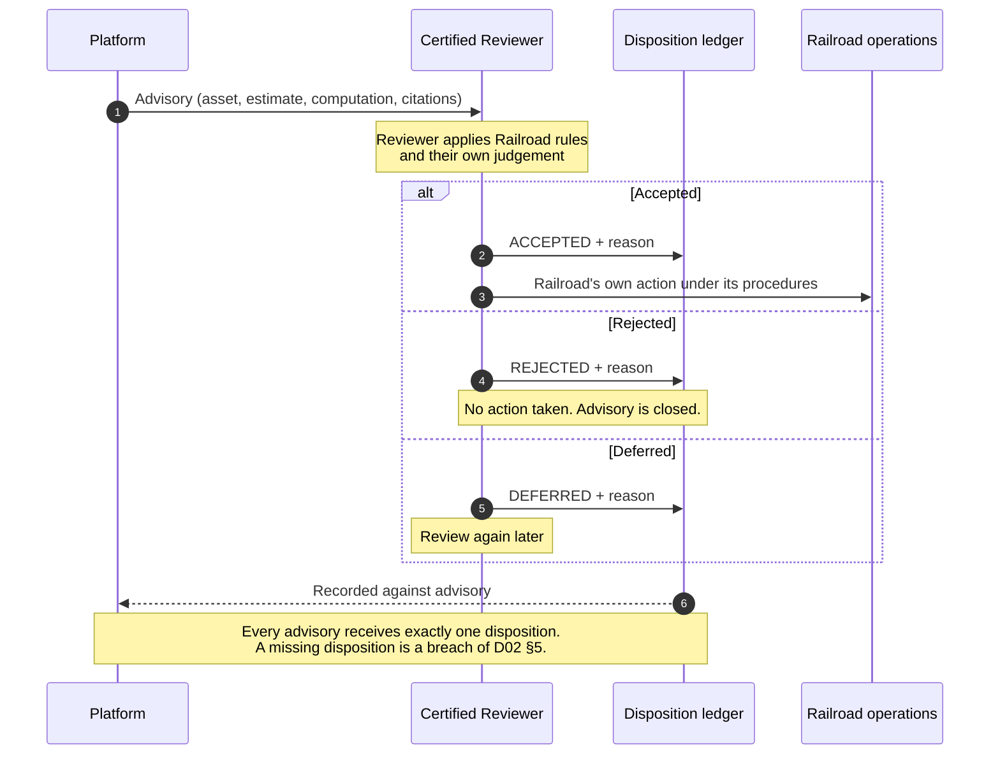
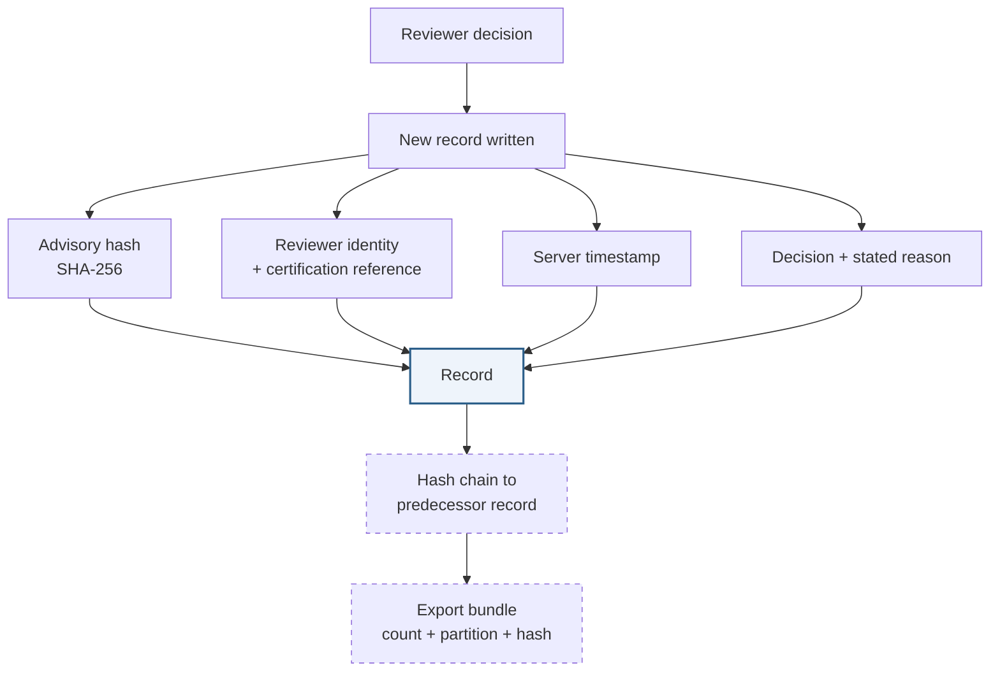
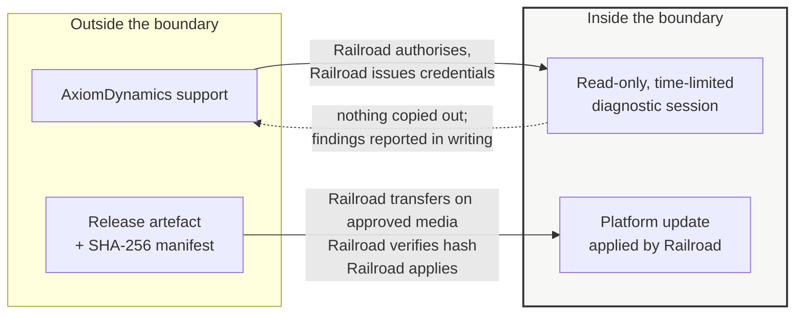
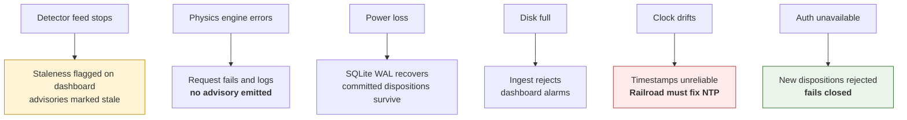

# B02 — Flow Map

**Docket position:** B02. The visual companion to B01. Where B01 describes the system in prose and component tables, this shows it as movement — what enters, what is computed, where a human intervenes, what is recorded, and what leaves.

**Classification:** Client-facing. Descriptive annex — creates no warranty (D00 Part IV rule 7).

> **Read this with B01 §3.** B01 §3 is the authoritative text description of the flow. If this diagram and B01 §3 ever disagree, **B01 governs** and this document is corrected. A diagram is easier to read and easier to get wrong.

> **What is solid and what is dotted.** Every box and arrow drawn with a solid line exists in the code today. Every dotted element is labelled as a production requirement not yet built, and each maps to the gap list in **B01 §7**. This distinction is the point of the document: a flow map that draws the intended system as though it were the shipped one is the most common way a vendor misleads a customer without ever writing a false sentence.
>
> **The convention, and where §2 stands against it.** Every section of this map describes code that exists. §2 was the exception until 2026-11-11, when the ingest validation chain was built; its diagram is no longer dotted, because the path it draws is now real. Two parts of §2 remain unbuilt and are labelled as such in the section itself rather than in a diagram: the Railroad's own payload schema, and authentication on the endpoint.

---

## 1. The whole system on one page

**There is no arrow leaving the boundary.** Not to us, not to a licence server, not to a telemetry endpoint. That is AD-1 drawn rather than asserted, and it is verified against the code in B05.

**The yellow box is the only place a decision is made.** Everything to its left computes. Everything to its right records. Nothing in the system decides.

---

## 2. What enters — the ingest path

> **Built 2026-11-11, and this is the precise claim.** The validation chain below now exists in code: `backend/ingest.py`, served at `POST /api/ingest`. It implements these three gates in this order and fails closed — a refused payload emits no advisory and is logged with a named reason. What is **not** done: the payload schema is a versioned **demonstration** schema (`axiom-detector-payload/v1`) built from the fields the physics engine consumes, not the schema agreed with the Railroad; and the endpoint has **no authentication**, which is the AD-2 gap (B01 §7 item 1) and the reason it must not be exposed beyond the Railroad's own collector on a trusted segment. **An unauthenticated ingest route is a data-poisoning route** — that sentence belongs here rather than in a footnote. The demonstration fleet still generates its signals from physics equations on synthetic traces (B01 §7 item 5), so **ingesting a real payload does not make the demo's numbers real**; it makes that payload real.

**The design intent: malformed input fails closed.** It does not produce a low-confidence advisory; it produces no advisory and a log entry. The distinction matters: a system that emits a weak signal for a bad reading teaches reviewers to ignore weak signals. **The chain now runs as drawn.** `H` stays dotted because the demonstration fleet is not wired to ingested readings — an accepted payload is validated and logged, and the physics engine would score it, but the demo's rankings still come from synthetic traces.

> **Current state, stated plainly.** The chain above is built and tested (24 tests), and every element of the diagram is real code rather than a requirement. Three things remain open and are not smoothed over: **the schema** is a demonstration schema and the real one must be defined, versioned and agreed with the Railroad; **authentication** on the endpoint does not exist, so it is safe only on a trusted segment until AD-2 lands; and **nothing downstream is wired to ingested readings yet** — an accepted payload is validated and logged, but the demonstration fleet still scores synthetic traces, so every number in a demonstration is still a demonstration of the method, not of the Railroad's data. **No customer's IT reviewer should be told otherwise.**

---

## 3. What is computed — the physics path

**Deterministic, not learned.** The models are equations with fixed parameters. They do not train on your data, do not improve from your fleet, and do not carry weights derived from another carrier. Given the same input they produce the same output, today and in five years.

**Why that is the argument, not a limitation.** A learned model cannot be explained to a regulator, cannot be reproduced by the Railroad's own engineer, and changes behaviour when it is retrained. A physics model can be audited line by line, and its output can be recomputed from the input by anyone holding the documentation. **That is what makes a disposition defensible two years later.**

**Every warrant carries its computation.** The reviewer sees not only "asset ranked 3" but the readings, the model outputs, and the thresholds that produced the ranking. A reviewer who cannot see why is not reviewing; they are ratifying.

---

## 4. The human loop — where the decision happens

**Three outcomes, no others.** Accepted, Rejected, Deferred. There is no "ignore," no "dismiss," and no auto-close. A platform that lets advisories disappear without a record cannot support the claim that every advisory was considered.

**The reviewer is a Railroad employee, certified under C02, acting under Railroad authority.** We do not review advisories. We do not record dispositions. We cannot see them. D14 §2 draws that boundary and this diagram should be read as its illustration.

> **Where we stop, in words we use on the phone:** *"The Platform shows this assessment and how it was computed. Whether to act on it is your operating decision under your rules. I can tell you what the Platform computed; I cannot tell you whether to move the train."* — D06 §1.4

---

## 5. What is recorded — the disposition ledger

> **Dotted = designed, not built.** Three things in this diagram are requirements rather than current behaviour. One of the three has since been built and one has narrowed; a customer's IT reviewer will find each in **B01 §7**.
>
> **1. The ledger is append-only — built 2026-11-09.** Each disposition is a new row; a correction carries a `supersedes_id` naming the row it corrects; `UPDATE` and `DELETE` are refused by database triggers; every row is SHA-256 chained to its predecessor and the chain is verifiable on demand. Corrections are new records, never edits, and the earlier record keeps its own timestamp. (B01 §4.1, §4.6, §7 item 2; AD-3.)
>
> **2. Reviewer identity is not yet cryptographically registered.** Dispositions carry a free-text name and certification ID, not a verified credential. (B01 §7 item 1; AD-2; target Q2 2027 per D09 §4.4.)
>
> **3. The export is signed and independently verifiable — built 2026-11-09; the signature's limits are not.** A signed bundle carries a partition boundary, record count, head hash and the whole content, and `tools/verify_ledger_export.py` checks it without importing Platform code, so the Customer verifies it on their own machine. It detects altered, added, removed and reordered records, and a ledger that has shrunk since a bundle the Customer already holds. What the HMAC signature **cannot** do is name the signer (it is symmetric), prove when it was signed (no timestamping authority on an air-gapped box), or detect a ledger wiped before the first bundle in a series; and nothing replicates off-box on a schedule — a destroyed disk still destroys the ledger. (B01 §4.5a, §7 items 11–12; D09 §4.4 and §4.5.)
>
> **What this means in practice:** the ledger now proves what the record says, that its content has not changed, and — because superseded rows survive — that the decision history is complete as written. An export proves the Customer received exactly that, verifiably and without trusting us. It does **not** prove who wrote a disposition (item 2) or who signed a bundle (item 3), and it cannot prove tamper-freedom against a party holding the database file, who could drop the triggers, rewrite rows and recompute the chain between exports. Say the first; do not claim the second.

**Corrections are new records, never edits.** Where a signed disposition contains an error, the correction is a new record referencing the original (Form F09 Part 8). The original stays. That is the only mechanism that preserves a history worth having.

---

## 6. What leaves the box — the support and update paths

Both of these are paths *into* the boundary, controlled by the Railroad. Neither is outbound.

**Support runs in your direction.** You authorise a session, you issue a temporary credential, you set the duration, and you revoke it. Nothing is copied out — diagnostics are performed in place and findings are reported in writing (D09 §3.4). **There is no standing remote access and we cannot connect to the edge box.**

**Updates are applied by you, not pushed by us.** We cannot reach the box. A release arrives as an artefact with a hash manifest; the Railroad verifies the hash, applies it on its own schedule, and records the application. That is a real constraint on us and a real control for you — and it is why the D06 patch windows are written as obligations on the Railroad's side, not ours.

> **Current state:** releases are not yet cryptographically signed, and dependency downloads are not yet hash-pinned (**B01 §7 item 7; D09 §4.4, which sets the target at Q2 2027**). The manifest described above is the target state. Until it exists, the sealed-archive method in C01 Part C provides a SHA-256 manifest of the transferred set, which the Railroad can verify independently — **the control is available today, it is just assembled at transfer rather than signed at release.**

---

## 7. What the Railroad gets out

| Output | Content | Mechanism | Status |
|---|---|---|---|
| **Advisory** | Asset, condition estimate, model computation, threshold basis | Dashboard | Present |
| **Disposition record** | Decision, reason, reviewer, timestamp, content hash | Ledger, exportable | Present — not append-only (§5) |
| **Quarterly performance report** | Advisory volume, disposition coverage, false-positive rate | Written report | Present per D06 §5.1 |
| **Data export on exit** | All Railroad data in documented machine-readable form | F13, 90 days at no charge | Present per D07 §15.6 |
| **Audit bundle** | Partition, record count, signed hash over contents | Signed export | **Not built** — target Q2 2027 (D09 §4.4) |

**Coverage is reported monthly and must be 100%.** Advisories generated ÷ dispositions recorded. A platform that generates 4,000 advisories a month and records 3,100 dispositions has not improved review — it has produced 900 unexamined judgements, and the record will show it. **F09 Part 9 requires the Railroad to compute and report this number.** We would rather be told our coverage is poor than have it discovered in a deposition.

---

## 8. Failure behaviour — what happens when a part stops

**Fails closed everywhere a choice exists.** The system refuses to act rather than acting unverified. A platform that produces plausible output when its inputs are broken is more dangerous than one that stops, because the output looks like information.

**One failure is ours to prevent and yours to fix: clock drift.** Timestamps come from the host clock. If NTP is not configured, every disposition record carries a time that may be wrong, and a record whose time is wrong is a record whose chronology cannot be relied upon. **F01 §4 asks this question before we ship, and F02 certifies the answer.** If the answer is "we do not run NTP," the honest position is that the disposition ledger is not admissible evidence, and we should say so before signing rather than after.

---

## 9. What this diagram is not

It is not a claim that the platform detects bearing failures. **It computes a physics-derived condition estimate and presents it to a qualified person** (D12 §1). It is not a claim that any particular proportion of defects will be found (D02 §7.2, D12 §8). It is not a safety appliance, a WDBD, an alarm system of record, or a substitute for any required inspection (D12 §§2–3).

And it is not a picture of the finished product. **Twelve items in B01 §7 stand between this diagram and the one we would draw for a production deployment.** Two of them — registered identity (item 1) and export signing-key provenance (item 11) — are the ones that make the record attributable, and both depend on the same unbuilt piece: the signed certification registry. We draw them dotted here because drawing them solid would be the single most effective way to mislead a customer while writing nothing false.

**And one of them is larger than the other eleven. The ingest path (§2) is not built at all** — the demonstration generates its own signals rather than accepting a Railroad's. A reviewer reading this map top to bottom should understand that the right-hand two-thirds is closer to production than the left-hand third is. **The ledger is built and its export is signed and independently verifiable; the front door does not yet exist.**

---

*Descriptive annex. Creates no warranty. Verified against the repository at time of writing. Any change to data flow, network behaviour, or the gap list requires revision of this document before release.*
